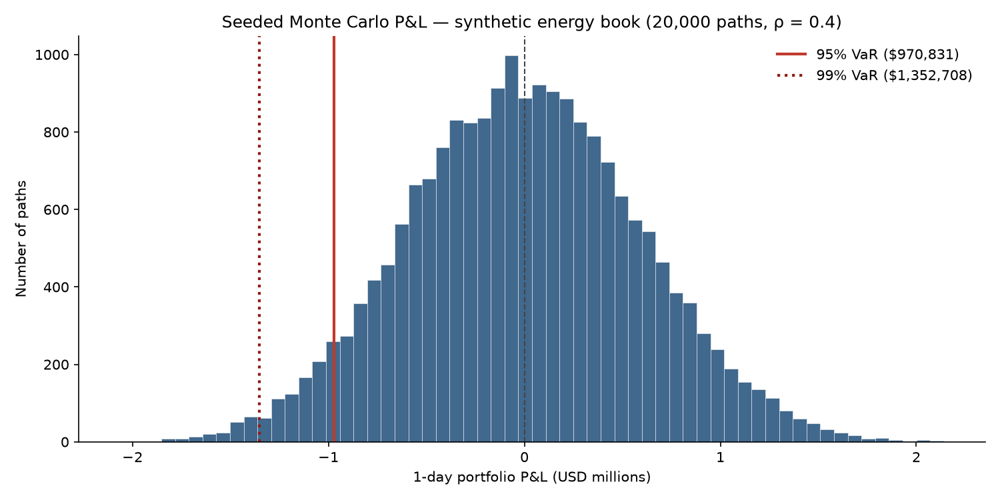

# VaR Agent

[](https://github.com/WaiteM124/var-agent/actions/workflows/ci.yml)

A proof-of-concept risk assistant for a **synthetic** 15-position energy-trading book. It has two paths:

- A **deterministic** core that filters positions, aggregates pre-computed VaR, runs a seeded Monte Carlo, and checks illustrative trading limits. This path needs no cloud credentials and is what CI and the worked example run.
- A **LangGraph** agent, exposed over FastAPI and a Streamlit UI, that answers natural-language questions by calling those same tools and, when asked about methodology, retrieving the notes in `docs/` from Azure AI Search. That path needs Azure OpenAI and Azure AI Search.

This is a demo, not a production ETRM or a live market-risk engine. It must not be used for real trading decisions. The book is invented (named traders, made-up notionals); nothing here is live market data.

## Problem

Risk desks get the same questions repeatedly: what is book VaR, who is concentrated, is anyone over a limit. An LLM can help only if the numbers come from testable functions, not from the model’s memory, and only if the limits of the calculation are explicit.

## Architecture

```mermaid
flowchart LR
  subgraph offline [No cloud credentials]
    Example["examples/run_var_example.py"]
    Risk["risk package"]
    CSV["Synthetic positions CSV"]
    Example --> Risk
    API["FastAPI /portfolio /controls /monte-carlo"] --> Risk
    Risk --> CSV
  end
  subgraph agentpath [Azure credentials required]
    UI[Streamlit "Ask the agent"] --> Query["FastAPI POST /query"]
    Query --> Agent[LangGraph agent]
    Agent --> Risk
    Agent --> LLM[Azure OpenAI]
    Agent --> Search[Azure AI Search]
    Search --> Docs["docs/*.md"]
  end
```

The Streamlit **Limit checks** and **Monte Carlo** tabs call the `risk` package in-process and do not need the API or Azure. The **Ask the agent** tab posts to `POST /query`, which is the only route that constructs Azure clients, and only when it is called.

## How the agent decides

On a natural-language question the graph starts at an LLM node with four tools:

| Tool | What it actually does |
|---|---|
| `get_positions` | Filters the CSV by trader, desk, or commodity |
| `calculate_portfolio_var` | **Sums** the pre-computed `var_95_1d` / `var_99_1d` columns on the selected rows. It does not re-price the book or run Monte Carlo |
| `check_trading_controls` | Runs the deterministic limit checks described below |
| `get_risk_methodology` | Embeds the question with Azure OpenAI and retrieves chunks from Azure AI Search (the markdown in `docs/`, once indexed) |

The model is instructed to quote position IDs and dollar amounts from tool output and not to invent figures. There is no write-back to a trading system.

## Governance and controls

`risk.controls.check_limits` applies a configurable `LimitConfig` (defaults: $5m per position, $15m per trader, $25m per desk, $2m book 95% VaR, 70% commodity concentration). On this sample book the defaults flag **P010** (notional $6.5m), **John Smith** ($15.6m), and the **Crude Oil** desk ($29.6m). Book 95% pre-computed VaR is $1,886,960, under the $2m VaR limit.

These are illustrative post-hoc checks on a static file. They are not a pre-trade gate, they are not connected to an order-management system, and they do not implement the regulatory topics discussed in `docs/trading_controls.md`.

`POST /query` requires `Authorization: Bearer $AGENT_API_KEY` and returns **503** if the key is unset. `/health`, `/portfolio`, `/controls`, and `/monte-carlo` are unauthenticated and are intended only for local demonstration.

## Worked example

The figures below were produced by `python examples/run_var_example.py` with seed 42, 20,000 paths, and constant pairwise correlation 0.4. No cloud credentials were used. Re-running the script rewrites `examples/output/`.

| Measure | 95% | 99% |
|---|---:|---:|
| Pre-computed book VaR (sum of position columns) | $1,886,960 | $2,830,440 |
| Undiversified parametric VaR (sum of \|N\|σz) | $1,552,413 | $2,195,607 |
| Monte Carlo portfolio VaR | $970,831 | $1,352,708 |
| Monte Carlo expected shortfall | $1,199,974 | $1,515,890 |

Book notional is **$41,350,000** across 15 positions.

These three VaR figures are *supposed* to differ:

- The **pre-computed** columns on the CSV are mostly `notional × volatility × 2` (95%) or `× 3` (99%). One row, P002, is slightly below that rule. This is a data artefact, not a model output.
- **Parametric** VaR uses standard normal quantiles (z₉₅ ≈ 1.645, z₉₉ ≈ 2.326) and is summed across positions with no diversification.
- **Monte Carlo** VaR is a one-day geometric Brownian motion, zero drift, daily volatilities from the book, options treated with a **delta approximation only** (no gamma, vega, or expiry), and a single pairwise correlation of 0.4. Diversification is why the MC 95% VaR sits well below the undiversified parametric sum.



Default limit breaches from the same run: P010 notional, John Smith trader notional, and the Crude Oil desk notional, as listed in `examples/output/summary.md`.

## Stack

Python 3.11+, pandas, NumPy, pytest, ruff, FastAPI, LangGraph, Azure OpenAI, Azure AI Search, Streamlit. Matplotlib is used only for the example chart.

## Run locally

Deterministic core, tests, and the worked example (no Azure):

```bash
python -m venv .venv
source .venv/bin/activate          # Windows: .venv\Scripts\activate
pip install -e ".[dev]"
pytest -q
python examples/run_var_example.py
```

FastAPI, including the unauthenticated demo endpoints:

```bash
pip install -r requirements.txt        # or: pip install -e ".[app]"
uvicorn main:app --reload --port 8000
# GET  http://localhost:8000/health
# GET  http://localhost:8000/portfolio
# GET  http://localhost:8000/controls
# POST http://localhost:8000/monte-carlo
```

Natural-language `/query` and the Streamlit **Ask the agent** tab also need a `.env` (see `.env.example`) with `AGENT_API_KEY`, `AZURE_OPENAI_ENDPOINT`, `AZURE_OPENAI_KEY`, `AZURE_SEARCH_ENDPOINT`, and `AZURE_SEARCH_KEY`. Then:

```bash
pip install -r streamlit_requirements.txt
streamlit run streamlit_app.py
```

The Streamlit **Limit checks** and **Monte Carlo** tabs run without that configuration. A UI screenshot is not included: those tabs run in-process against the `risk` package, and the natural-language tab cannot be exercised without Azure credentials.

### Environment variables

| Variable | Used for |
|---|---|
| `AGENT_API_KEY` | Bearer token for `POST /query` |
| `AGENT_URL` | Streamlit target for `/query` (default `http://localhost:8000`) |
| `AZURE_OPENAI_ENDPOINT` | Azure OpenAI resource URL |
| `AZURE_OPENAI_KEY` | Azure OpenAI key |
| `AZURE_OPENAI_DEPLOYMENT` | Chat deployment (default `gpt-4o`) |
| `AZURE_OPENAI_EMBEDDING_DEPLOYMENT` | Embedding deployment (default `text-embedding-3-small`) |
| `AZURE_OPENAI_API_VERSION` | Default `2024-02-01` |
| `AZURE_SEARCH_ENDPOINT` | Azure AI Search endpoint |
| `AZURE_SEARCH_KEY` | Azure AI Search key |
| `AZURE_SEARCH_INDEX` | Default `risk-docs` |

## Tests and CI

`pytest` and `ruff` run on every push via GitHub Actions (Python 3.12). The suite covers book aggregation, parametric and seeded Monte Carlo VaR, limit checks, and the FastAPI demo endpoints. It does not call Azure or an LLM. CI also re-runs the worked example.

```bash
ruff check .
ruff format --check .
pytest -q
```

## Status

Public showcase copy of a prototype, published with a clean git history. Hardcoded cloud endpoints and a default API key from the original tree were replaced with environment variables. Azure Blob Storage, Azure Key Vault, and Langfuse appeared in the original dependency list but are not used in this code and are not included here.
