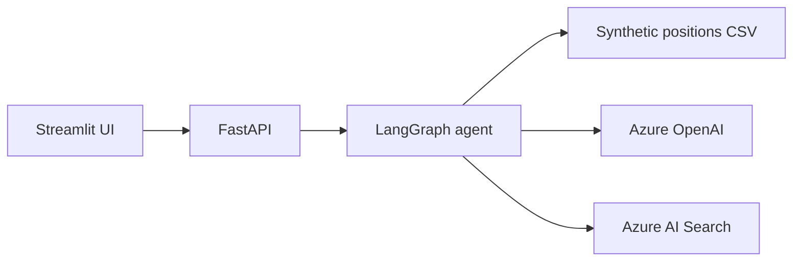

# VaR Agent

A LangGraph agent that answers natural-language questions about a **synthetic** energy-trading book: it filters positions, aggregates pre-computed 1-day VaR figures, and retrieves methodology notes (VaR, Monte Carlo, trading controls) via Azure AI Search.

This is a proof-of-concept / demo. It does not compute live market risk, does not connect to a production ETRM, and must not be used for real trading decisions.

## Architecture



The VaR tool sums `var_95_1d` / `var_99_1d` already present on the sample book; it does not run a Monte Carlo engine at query time. Docs under `docs/` describe the methods in prose and are intended to be indexed for retrieval.

## Run locally

```bash
python -m venv .venv
source .venv/bin/activate  # Windows: .venv\Scripts\activate
pip install -r requirements.txt
cp .env.example .env       # fill in Azure credentials and AGENT_API_KEY
uvicorn main:app --reload --port 8000
```

In a second terminal, with Streamlit installed (`pip install -r streamlit_requirements.txt`):

```bash
streamlit run streamlit_app.py
```

`POST /query` requires `Authorization: Bearer $AGENT_API_KEY`. `/health` is unauthenticated.

## Status

Showcase copy of a public prototype, published with a clean git history. Hardcoded cloud endpoints and default API keys from the original tree have been replaced with environment variables. Tests and CI will follow.
