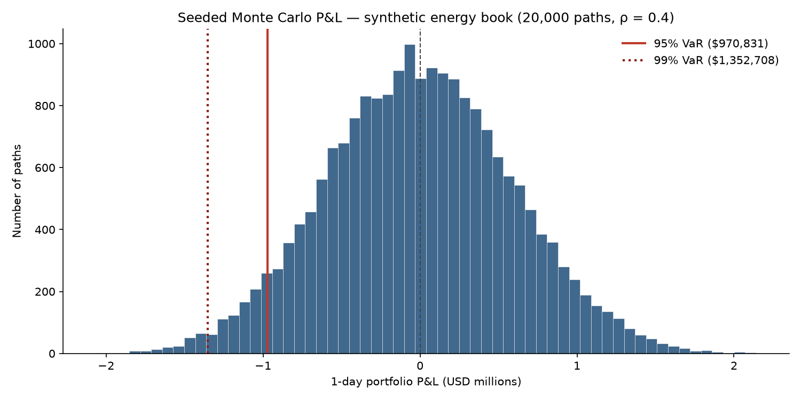

# Worked example output

Generated by `examples/run_var_example.py` with seed 42, 20,000 paths, and constant pairwise correlation 0.4. No cloud credentials were used.

| Measure | 95% | 99% |
|---|---:|---:|
| Pre-computed book VaR (sum of position columns) | $1,886,960 | $2,830,440 |
| Undiversified parametric VaR (sum of |N|σz) | $1,552,413 | $2,195,607 |
| Monte Carlo portfolio VaR | $970,831 | $1,352,708 |
| Monte Carlo expected shortfall | $1,199,974 | $1,515,890 |

Book notional: $41,350,000 across 15 synthetic positions.

Default limit breaches:

- `POSITION_NOTIONAL` — Position P010 notional 6,500,000 exceeds 5,000,000
- `TRADER_NOTIONAL` — Trader John Smith notional 15,600,000 exceeds 15,000,000
- `DESK_NOTIONAL` — Desk Crude Oil notional 29,600,000 exceeds 25,000,000

